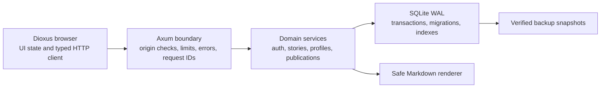

# fastMedium architecture and hardening plan

## Product direction
A dependable publishing app for writing, discovering stories, maintaining an author profile, and curating publications. Keep the current blush/coral design and the independent Dioxus browser + Axum/Tokio API. “Best” is a product ambition; this plan uses measurable acceptance checks rather than claiming feature parity with Medium.

## Architecture

Use a modular monolith: one API process, shared serializable contracts, explicit domain modules, and one database. A service split would add deployment and consistency problems without solving the current app's needs. Keep credentials and database code out of the Wasm build. Keep authorization at the domain boundary, independently of UI visibility.

## Current audit
- Markdown HTML is passed into the reader without filtering raw HTML or unsafe links.
- Updates have no revision precondition; concurrent tabs can silently overwrite writing.
- Slug creation checks then inserts, leaving a concurrent-create race.
- Migrations split SQL on semicolons and have no transactional version ledger.
- Feed search filters only the current client page; pagination arithmetic can overflow.
- Database details leak through 400 responses; ownership failures use misleading statuses.
- Session tokens are stored as bearer credentials; password jobs are unbounded.
- Readiness reports success without checking database access. Requests lack deadlines and correlation IDs.
- Story deletion has no second-step UI confirmation.

## Implementation now: dependable core
- [ ] Transactional, versioned additive migrations; WAL/busy timeout and startup failures before listening.
- [ ] Safe Markdown: raw HTML displayed as text, dangerous URL schemes removed, regression coverage.
- [ ] Validate story/account fields and bound expensive password work; rate-limit auth attempts.
- [ ] Hash stored session tokens, preserve existing sessions through migration, configurable secure cookies.
- [ ] Enforce trusted mutation origins, consistent JSON errors, request IDs, deadlines and no-store headers.
- [ ] Optimistic concurrency for story saves; stale versions return 409 and preserve the editor's unsaved text.
- [ ] Race-safe slugs, idempotent publishing, consistent ownership statuses and deterministic pagination.
- [ ] Server-side search across all published stories, pagination reset on search, useful retry states.
- [ ] Confirm story deletion and disable duplicate workspace actions.
- [ ] Add a backup utility with integrity checks and document restore and deployment boundaries.
- [ ] Expand isolated API tests, run Rust/browser build checks, and verify the running UI.

## Acceptance criteria
Existing accounts, content, skills, publication membership, and valid sessions survive upgrade and restart. No raw executable markup reaches the reader. Two edits from the same version yield one successful save and one conflict. Concurrent identical titles receive unique nonempty slugs. Drafts stay private. Cross-origin mutations fail before side effects. Search returns matches beyond page one. Bad input and missing resources produce explicit statuses; database internals and credentials never appear in responses/logs. A verified backup can be restored to a separate database and opened successfully.

## Next product increments (separate from this hardening release)
1. Recoverable draft autosave and revision-history UI, bookmarks, follow authors, and accessible reader preferences.
2. Publication editor roles/invitations and moderation/reporting, with an explicit permission matrix and audit trail.
3. Email verification/reset flow and a transactional notification outbox with bounded retries; current email is best effort and not a delivery guarantee.
4. Public deployment: same-origin HTTPS reverse proxy, secure cookies, trusted origins, backup retention/restore drills, abuse controls and uptime monitoring. Current single-node limiter is not a distributed defense.
5. Search indexing and cursor pagination when measured volume justifies it; PostgreSQL migration only when concurrent write load or deployment needs exceed SQLite. Public article metadata/SSR or prerendering is needed before promising search-engine visibility.

Do not add payments, third-party analytics, external messages, or a public deployment during this pass. Track verified completion in ISSUES.md; leave future product increments explicitly unimplemented.
